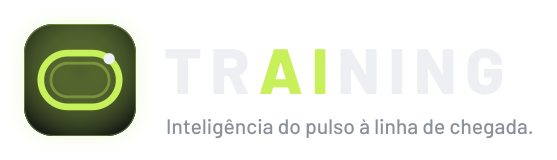

<p align="center">
  <picture>
    <source media="(prefers-color-scheme: dark)" srcset="docs/assets/logo-dark.svg">
    <source media="(prefers-color-scheme: light)" srcset="docs/assets/logo-light.svg">
    
  </picture>
</p>

<p align="center">
  
</p>

App nativo de iPhone e iPad para corrida. Lê sono, HRV e treinos do Garmin ou do Apple Watch e calcula no aparelho a prontidão do dia, a análise de cada treino, a evolução, a previsão de prova e um plano com corrida e força. O que o app faz para quem usa está na landing, em [training.aglv.dev](https://training.aglv.dev). Este README é para quem vai rodar ou mexer no código.

Versão atual: `1.7.2` (ver [Versão](#versão)).

## Estrutura do repositório

| Pasta | O que tem |
| --- | --- |
| `App/` | App SwiftUI (iPhone e iPad): telas, modelos de tela, conta, ajustes e integrações |
| `Widgets/`, `Shared/` | Widgets da tela inicial e da tela bloqueada, e os tipos que eles dividem com o app |
| `Packages/TrainingKit/` | Pacote Swift com a lógica, testável sem o app (módulos abaixo) |
| `Watchface/` | Mostrador Connect IQ para o Forerunner 965 ([README](Watchface/README.md)) |
| `server/` | API na Vercel (Node 22 + Neon Postgres) e a landing em `server/landing/` ([README](server/README.md)) |
| `docs/regras/` | Regras de análise ([`analise.md`](docs/regras/analise.md)) e de prescrição ([`prescricao.md`](docs/regras/prescricao.md)) |
| `docs/superpowers/` | Specs e planos de design das primeiras versões |
| `scripts/` | `dev-run.sh` (simulador) e `release.sh` (versão) |
| `project.yml` | Projeto do Xcode, gerado pelo XcodeGen. O `.xcodeproj` não fica no git |

| Módulo do `TrainingKit` | Papel |
| --- | --- |
| `GarminAPI`, `FITReader`, `HealthImport` | Leitura do Garmin Connect, dos arquivos `.FIT` e do Apple Saúde |
| `Sync`, `Storage` | Sync incremental e persistência em SwiftData |
| `TrainingCore`, `Metrics`, `WorkoutAnalysis`, `Projections` | Prontidão, carga, zonas, nota do treino, previsões e projeções |
| `Insights`, `Narrative`, `Reports` | Leituras em texto, relatório da semana e avisos |
| `MFIT` | Treinos de força do MFIT Personal |
| `RemoteSync` | Cliente da API do servidor: conta, registros, Garmin e relógio |
| `trainingctl` | CLI que roda o sync e reprocessa um `store.sqlite` fora do app |

## Como os dados andam

- **Garmin:** o login com a conta Garmin passa pelo servidor (SSO mobile da Garmin, com código por e-mail quando a conta pede). O servidor guarda a sessão cifrada e não guarda a senha. O app pega a sessão em `GET /api/v1/garmin/session` e busca os dados direto no Garmin Connect.
- **Apple Watch:** o app lê o Apple Saúde (treinos, rotas, FC, HRV, sono e FC de repouso) e manda os treinos do plano para o relógio pelo WorkoutKit. Nada do Apple Saúde vai para o servidor.
- **No aparelho:** dados diários, atividades e tudo o que é calculado ficam em SwiftData. Os `.FIT` são baixados, processados e descartados.
- **No servidor:** conta e sessões, convites, a sessão da Garmin, o token do Strava, a nota que o mostrador lê, os tokens do MCP e os registros que sincronizam entre aparelhos (provas, metas, decisões, plano do treinador, leituras, preferências e conversas). Os registros chegam em JSON e o servidor cifra com `DATA_KEY` (AES-256-GCM) antes de gravar.
- **Texto e conversa:** Foundation Models da Apple, no aparelho, a partir de números já calculados. Sem o modelo, o app usa templates com os mesmos números.

As fórmulas e os limites estão em `docs/regras/`. Mudança de regra atualiza esses arquivos no mesmo commit.

## Requisitos

- iPhone ou iPad com iOS/iPadOS 26 ou mais novo.
- Mac com Xcode e SDK do iOS 26 ou mais novo, e [XcodeGen](https://github.com/yonaskolb/XcodeGen) (`brew install xcodegen`).
- Uma conta Apple. A conta gratuita (Personal Team) basta.
- Relógio Garmin com conta no Garmin Connect, ou Apple Watch.
- Para o servidor, Node 22. Para o mostrador, Java 17 e o Connect IQ SDK.

## Rodar o app

```bash
git clone https://github.com/adrianogl/training.git
cd training
xcodegen generate
open trAIning.xcodeproj
```

No Xcode, em Signing & Capabilities dos targets `trAIning` e `TrainingWidgets`, escolha o seu time (com a conta gratuita aparece como "Personal Team"). Se o bundle id `dev.aglv.training` já estiver em uso por outra conta, troque o prefixo em `project.yml` e gere o projeto de novo.

Conecte o iPhone ou o iPad por cabo, escolha o aparelho como destino e rode. Na primeira vez, o iOS pede para confiar no desenvolvedor em Ajustes › Geral › VPN e Gerenciamento de Dispositivos e para ligar o Modo de Desenvolvedor.

### Primeiro uso

1. **Conta.** O app abre no login. O cadastro é só por convite: o link do e-mail abre `training://convite?c=…` no aparelho com o app instalado. Os e-mails em `ADMIN_EMAILS` do servidor criam conta sem convite e veem Ajustes › Convites.
2. **Relógio.** Escolha Garmin ou Apple Watch. Dá para trocar depois em Ajustes › Relógio.
   - Garmin: e-mail e senha da Garmin e, se pedir, o código que chega por e-mail.
   - Apple Watch: autorize a leitura do Apple Saúde e a escrita de treinos agendados.
3. **Primeira carga.** O app baixa o histórico disponível e já fica usável com o que chegou. A carga completa leva alguns minutos.

### Integrações opcionais

| Onde | O que faz |
| --- | --- |
| Ajustes › Strava | Escreve o resumo do treino na descrição da atividade |
| Ajustes › MFIT | Lê o programa de força que o professor montou no MFIT Personal |
| Ajustes › Claude | Gera um token para o Claude Desktop ou o Claude Code montarem treinos de força pelo MCP em `https://training.aglv.dev/mcp`. O app mostra o comando pronto; os treinos só entram depois que você revisa e aplica |
| Ajustes › Mostrador | Token do mostrador Garmin e a agenda no relógio |
| Treinador › Enviar ao Garmin | Manda os treinos do treinador para o relógio: só força, só corrida ou os dois. O app só mexe nos treinos que ele mesmo criou |

### Conta gratuita: reinstalar a cada 7 dias

Com a conta gratuita, o perfil de instalação vence 7 dias depois de cada instalação e o app para de abrir. Para voltar a usar, conecte o aparelho e rode de novo pelo Xcode (Product › Run). Os dados ficam, porque o bundle id é o mesmo.

### Simulador

`scripts/dev-run.sh` gera o projeto, cria um simulador, compila, instala e abre o app. O script copia um banco de `garmin-data/snapshot/` (pasta fora do git) para o simulador; sem ele, use `--snapshot <pasta>` com um `store.sqlite` seu. Se existir `~/.config/garmin/connect-personal-api-key`, a chave vai para o app pela variável `TRAINING_API_KEY`.

```bash
scripts/dev-run.sh               # compila e abre no simulador
scripts/dev-run.sh --test        # roda os testes do app
scripts/dev-run.sh --reset-data  # copia o snapshot de novo
```

## Testes

```bash
scripts/dev-run.sh --test                       # app, com snapshots das telas
swift test --package-path Packages/TrainingKit  # TrainingKit
npm --prefix server ci
npm --prefix server test                        # servidor, contra PGlite, sem rede
npm --prefix server run typecheck
```

## Servidor

Vercel Functions (Node 22) com Postgres no Neon. Variáveis de ambiente, rotas e o protocolo de sync estão em [`server/README.md`](server/README.md). Para subir o seu:

```bash
cd server
npm ci
DATABASE_URL=... npm run migrate
vercel deploy --prod
```

O mínimo é `DATABASE_URL`, `DATA_KEY` e `ADMIN_EMAILS`. Os e-mails de convite e senha pedem `RESEND_API_KEY`, `MAIL_FROM` e `APP_URL`; o Strava pede `STRAVA_CLIENT_ID` e `STRAVA_CLIENT_SECRET`. Depois, aponte `remoteSyncBaseURL` em `App/AppConstants.swift` para o seu domínio.

O build da Vercel roda as migrations e copia `server/landing/` para `public/`. A landing é HTML e CSS estáticos; `link.html` atende os links de e-mail (`/convite`, `/confirmar`, `/redefinir-senha`) com o botão "Abrir no app".

## Mostrador do relógio

Connect IQ para o Forerunner 965: prontidão, VO2max, km da semana e o próximo compromisso da agenda. Compilar, instalar e trocar a foto de fundo: [`Watchface/README.md`](Watchface/README.md).

## Versão

O app segue semver, a partir da `v1.0.0`. A versão sobe pelos commits desde a última tag `v*`: `feat` sobe o minor, `fix` e `perf` sobem o patch, `!` no tipo ou `BREAKING CHANGE` no corpo sobem o major. `chore`, `docs`, `refactor` e `test` não geram versão.

```bash
scripts/release.sh --dry-run   # mostra a próxima versão e os commits
scripts/release.sh             # grava MARKETING_VERSION e CURRENT_PROJECT_VERSION no project.yml
```

Depois: commit `chore(release): vX.Y.Z`, tag `vX.Y.Z` e push com `--tags`. O rodapé de Ajustes mostra a versão, o build, o commit e o horário do build.

## Privacidade

- Dados de saúde e treinos da Garmin vão do Garmin Connect direto para o aparelho. Dados do Apple Saúde não saem do aparelho.
- O servidor guarda só o que sincroniza entre aparelhos e os tokens das integrações, cifrados com `DATA_KEY`. Quem administra o servidor tem essa chave.
- A senha da Garmin não é guardada, só a sessão, cifrada. Em Ajustes dá para desconectar a Garmin e o Strava, revogar o token do Claude e apagar a conta com tudo o que ela tinha no servidor.
- Sem telemetria e sem analytics. O log de requisições guarda método, rota, status e o começo do id da conta por 7 dias, sem payload nem IP.
- Nenhum dado pessoal, chave, `.FIT`, foto ou resposta de API faz parte deste repositório. A foto do mostrador fica fora do git.

## Aviso

Projeto pessoal, fora da App Store, sem vínculo com Garmin, Apple, Strava ou MFIT. Os nomes aparecem só como referência à origem dos dados.
