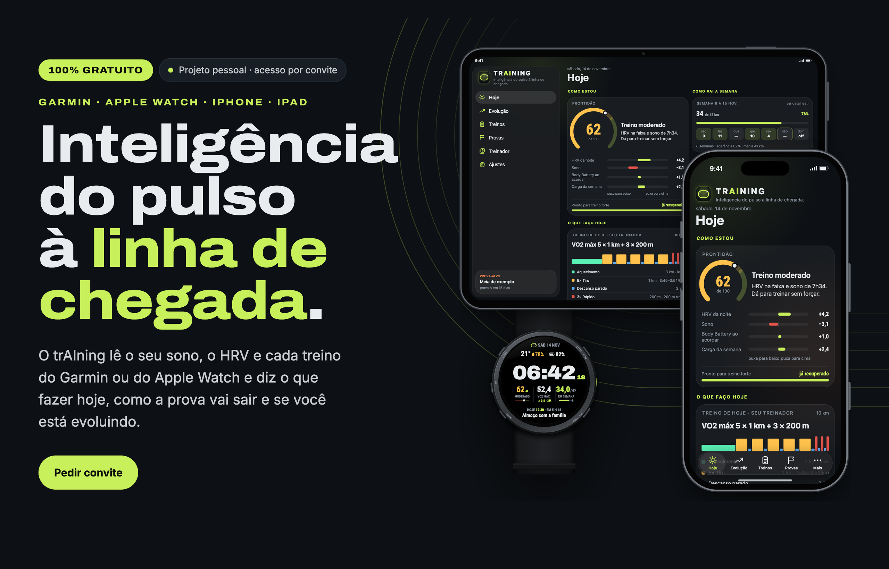

<p align="center">
  <picture>
    <source media="(prefers-color-scheme: dark)" srcset="docs/assets/logo-dark.svg">
    <source media="(prefers-color-scheme: light)" srcset="docs/assets/logo-light.svg">
    
  </picture>
</p>

<p align="center">
  <a href="https://github.com/adrianogl/training/tags"></a>
  
  
  
  
  <a href="https://github.com/adrianogl/training/commits/main"></a>
</p>

<p align="center">
  
  
  
  
  
  
</p>

<p align="center">
  
  
  
  
  
</p>

<p align="center">
  
</p>

App nativo de iPhone e iPad para corrida. Lê sono, HRV e treinos do Garmin ou do Apple Watch e calcula no aparelho a prontidão do dia, a análise de cada treino, a evolução, a previsão de prova e um plano com corrida e força. O que o app faz para quem usa está na landing, em [training.aglv.dev](https://training.aglv.dev). Este README é para quem vai rodar ou mexer no código.

Versão atual: `1.55.1` (ver [Versão](#versão)).

## Estrutura do repositório

| Pasta | O que tem |
| --- | --- |
| `App/` | App SwiftUI (iPhone e iPad): telas, modelos de tela, conta, ajustes e integrações |
| `Widgets/`, `Shared/` | Widgets da tela inicial e da tela bloqueada, e os tipos que eles dividem com o app |
| `Packages/TrainingKit/` | Pacote Swift com a lógica, testável sem o app (módulos abaixo) |
| `Watchface/` | Mostrador Connect IQ para o Forerunner 965 ([README](Watchface/README.md)) |
| `ForcaApp/` | App Connect IQ de força ao vivo para o Forerunner 965 e o Venu 3 ([README](ForcaApp/README.md)) |
| `server/` | API na Vercel (Node 22 + Neon Postgres) e a landing em `server/landing/` ([README](server/README.md)) |
| `docs/regras/` | Regras de análise ([`analise.md`](docs/regras/analise.md)) e de prescrição ([`prescricao.md`](docs/regras/prescricao.md)) |
| `docs/superpowers/` | Specs e planos de design das primeiras versões |
| `scripts/` | `dev-run.sh` (simulador), `release.sh` (versão e `versao.json`), `auto_install.py` (reinstalação automática), `garmin-catalog.py` (catálogo de força a partir da lista da Garmin) e `exercise-media.py` (imagens e passos dos exercícios de força em `App/Strength/Media`) |
| `project.yml` | Projeto do Xcode, gerado pelo XcodeGen. O `.xcodeproj` não fica no git |
| `CLAUDE.md` | Comandos, convenções e cuidados para agentes, na raiz e em `App/`, `Packages/TrainingKit/`, `server/`, `Watchface/` e `ForcaApp/` |

| Módulo do `TrainingKit` | Papel |
| --- | --- |
| `GarminAPI`, `FITReader`, `HealthImport` | Leitura do Garmin Connect, dos arquivos `.FIT` e do Apple Saúde |
| `Sync`, `Storage` | Sync incremental e persistência em SwiftData |
| `TrainingCore`, `Metrics`, `WorkoutAnalysis`, `Projections` | Prontidão, carga, zonas, nota do treino, previsões e projeções |
| `Insights`, `Narrative`, `Reports` | Leituras em texto, relatório da semana e avisos |
| `MFIT` | Treinos de força do MFIT Personal |
| `RemoteSync` | Cliente da API do servidor: conta, registros, Garmin e relógio |
| `trainingctl` | CLI que roda o sync e reprocessa um `store.sqlite` fora do app |

## Como os dados andam

- **Garmin:** o login com a conta Garmin passa pelo servidor (SSO mobile da Garmin, com código por e-mail quando a conta pede). O servidor guarda a sessão cifrada e não guarda a senha. O app pega a sessão em `GET /api/v1/garmin/session` e busca os dados direto no Garmin Connect.
- **Apple Watch:** o app lê o Apple Saúde (treinos, rotas, FC, HRV, sono e FC de repouso) e manda os treinos do plano para o relógio pelo WorkoutKit. Nada do Apple Saúde vai para o servidor.
- **Strava:** o servidor guarda o token e, a pedido do app, lista as corridas do Strava (Run, TrailRun e VirtualRun) que não vieram de um aparelho Garmin (`GET /api/v1/strava/runs`) e busca as séries da corrida aprovada (`GET /api/v1/strava/run-streams`). A corrida é montada no aparelho e entra como uma do Garmin, com carga, análise e nota. Se a mesma corrida chegar depois pelo Garmin, a do Strava sai.
- **No aparelho:** dados diários, atividades e tudo o que é calculado ficam em SwiftData. Os `.FIT` são baixados, processados e descartados.
- **No servidor:** conta e sessões, convites, a sessão da Garmin, o token do Strava, a nota que o mostrador lê, os tokens do MCP e os registros que sincronizam entre aparelhos (provas, metas, decisões, plano do treinador, treinos já enviados ao Garmin, leituras, preferências e conversas). Os registros chegam em JSON e o servidor cifra com `DATA_KEY` (AES-256-GCM) antes de gravar.
- **Catálogo de força:** o treinador, a troca de exercício e os treinos do Claude usam o catálogo oficial de exercícios da Garmin (cerca de 1.350 exercícios, com nome em pt-BR e id `CATEGORIA/EXERCICIO`), embutido no app. O `scripts/garmin-catalog.py` gera o catálogo e deriva equipamento, padrão de movimento e região de dor. Os treinos do MFIT seguem com os exercícios do professor.
- **Imagens e passos dos exercícios:** a tela do exercício mostra um carrossel com as fotos do free-exercise-db (do próprio exercício e do equivalente), as imagens da wger e, por último, um desenho animado do padrão de movimento (16 padrões). 462 dos 1.358 exercícios do catálogo têm fotos revisadas, e os passos de execução estão em português.
- **Avaliação das imagens:** em cada imagem, "Corresponde" ou "Não corresponde" grava a avaliação no aparelho na hora e sincroniza. Ao recusar, dá para escolher outra foto do free-exercise-db, buscar na wger, usar o desenho ou descrever o que está diferente. O `scripts/exercise-media.py` monta o `exercise-media.json` e a pasta `Images/` em `App/Strength/Media`. Licenças e autores: [`CREDITS.md`](App/Strength/Media/CREDITS.md) (free-exercise-db em Unlicense, wger em CC-BY-SA).
- **Plano de força:** o plano de força tem objetivo (Performance na corrida, Força, Prevenção, Mobilidade para corrida ou Manutenção), equipamento disponível em casa, dias, validade (até a prova, de 1 a 24 semanas ou até uma data), início e quem monta (Treinador ou Claude). Os treinos aparecem só entre o início e o fim, e o MFIT segue em paralelo: no dia com os dois, a semana mostra os cards "MFIT" e "Plano". No fim, o iPhone avisa "Plano de <objetivo> terminou" e a tela Força oferece montar o próximo ou repetir o mesmo. Mobilidade é um foco próprio, sem carga. As regras estão em [`docs/regras/prescricao.md`](docs/regras/prescricao.md).
- **MFIT no relógio:** com "Enviar os treinos do MFIT" ligado em Enviar ao Garmin, os treinos do professor vão para o calendário do Garmin até o fim da prescrição, com o exercício do catálogo da Garmin quando o nome casa e o nome do professor quando não casa. O envio automático leva junto.
- **Excluir treino:** no detalhe do treino, o menu "…" tem "Excluir treino". O treino sai do app e das contas, e o id vai para uma lista de excluídos que sincroniza entre os aparelhos e que o sync do Garmin pula. Atividade gravada pelo app de força (`Training`) é apagada também no Garmin Connect; as outras continuam lá.
- **Aba Treinos:** abre nos treinos feitos e alterna entre Feitos, Semana e Mês. Semana é a semana do treinador, com o objetivo, o placar e os quadrados das semanas; o dia já treinado mostra o card do treino feito e os outros dias mostram o que o treinador prescreveu. O botão Plano abre o resto do treinador: Força, Enviar ao Garmin, mudanças do plano, longão, zonas, paces, ciclos anteriores e o menu do plano. O mês tem pontos por tipo (corrida feita, corrida planejada, força e MFIT) e os km de cada dia; tocar num dia mostra os treinos dele e o resumo do mês.
- **Observações e carga sugerida:** cada exercício guarda observações permanentes, de qualquer origem (treinador, Claude ou MFIT), e elas entram no contexto de força do Claude. As observações das séries do MFIT aparecem só para leitura. Nos treinos do Treinador e do Claude, o exercício com carga que você nunca fez recebe uma carga sugerida pelo histórico do mesmo padrão de movimento ou da mesma categoria da Garmin, e o app mostra a conta. Treino do MFIT mantém a carga do professor, a não ser no app de força no relógio: depois de um treino com todas as séries fechadas, o próximo começa com a carga que subiu, se ela passar a do professor. A regra está em [`docs/regras/prescricao.md`](docs/regras/prescricao.md).
- **Força ao vivo:** o app `Training` no relógio roda o treino de força do dia, que o iPhone manda depois de cada sync (o de hoje e o de amanhã). Cada série vai ao iPhone pelo Bluetooth (Connect IQ Mobile SDK), em 1 a 3 s, e aparece na tela ao vivo (Treinos › Plano › Força e um card na aba Hoje) e num Live Activity com ilha dinâmica. Quando o treino começa e o app não está na tela, o iPhone mostra uma notificação; o Live Activity aparece quando o app abre, porque o iOS só deixa criar com o app na tela. Ao salvar, o iPhone envia as séries para a atividade no Garmin Connect, que só recebe o envio se ainda não tiver nenhuma série, e grava a carga real no histórico. Cada série vai com o exercício do catálogo da Garmin; nos treinos do MFIT, o nome do professor é casado com o catálogo (`StrengthCatalogMatch`) e, sem casamento seguro, vai só a categoria. Nada disso passa pelo servidor.
- **Previsões e recordes:** distâncias fixas (1 km, 3 km, 5 km, 10 km, meia e maratona), recorde casado pela distância em metros e cada previsão comparada ao recorde da mesma distância.
- **Texto e conversa:** Foundation Models da Apple, no aparelho, a partir de números já calculados. Sem o modelo, o app usa templates com os mesmos números.

As fórmulas e os limites estão em `docs/regras/`. Mudança de regra atualiza esses arquivos no mesmo commit.

## Requisitos

- iPhone ou iPad com iOS/iPadOS 26 ou mais novo. O iPhone funciona na horizontal.
- Mac com Xcode e SDK do iOS 26 ou mais novo, e [XcodeGen](https://github.com/yonaskolb/XcodeGen) (`brew install xcodegen`).
- Uma conta Apple. A conta gratuita (Personal Team) basta.
- Relógio Garmin com conta no Garmin Connect, ou Apple Watch.
- Para o servidor, Node 22. Para o mostrador e o app de força, Java 17 e o Connect IQ SDK. O app de força no iPhone usa o Garmin Connect instalado para escolher o relógio.

## Rodar o app

```bash
git clone https://github.com/adrianogl/training.git
cd training
xcodegen generate
open trAIning.xcodeproj
```

No Xcode, em Signing & Capabilities dos targets `trAIning` e `TrainingWidgets`, escolha o seu time (com a conta gratuita aparece como "Personal Team"). Se o bundle id `dev.aglv.training` já estiver em uso por outra conta, troque o prefixo em `project.yml` e gere o projeto de novo.

Conecte o iPhone ou o iPad por cabo, escolha o aparelho como destino e rode. Na primeira vez, o iOS pede para confiar no desenvolvedor em Ajustes › Geral › VPN e Gerenciamento de Dispositivos e para ligar o Modo de Desenvolvedor.

### Primeiro uso

1. **Conta.** O app abre no login. O cadastro é só por convite: o link do e-mail abre `training://convite?c=…` no aparelho com o app instalado. Os e-mails em `ADMIN_EMAILS` do servidor criam conta sem convite e veem Ajustes › Convites.
2. **Relógio.** Escolha Garmin ou Apple Watch. Dá para trocar depois em Ajustes › Relógio.
   - Garmin: e-mail e senha da Garmin e, se pedir, o código que chega por e-mail.
   - Apple Watch: autorize a leitura do Apple Saúde e a escrita de treinos agendados.
3. **Primeira carga.** O app baixa o histórico disponível e já fica usável com o que chegou. A carga completa leva alguns minutos.

### Integrações opcionais

| Onde | O que faz |
| --- | --- |
| Ajustes › Strava | Escreve o resumo do treino na descrição da atividade e importa, com aprovação, as corridas do Strava sem par no Garmin dos últimos 12 meses (Corridas sem o relógio); avisa quando aparece uma nova |
| Ajustes › MFIT | Lê o programa de força que o professor montou no MFIT Personal. Com "Enviar os treinos do MFIT" ligado, manda o programa ao Garmin até o fim da prescrição |
| Ajustes › Claude | Gera um token para o Claude Desktop ou o Claude Code montarem treinos de força pelo MCP em `https://training.aglv.dev/mcp`. O app mostra o comando pronto; os treinos só entram depois que você revisa e aplica. Para administradores, o MCP também expõe `avaliacoes_imagens` e `resolver_avaliacao`, que listam e resolvem as avaliações de imagem dos exercícios |
| Ajustes › Mostrador | Token do mostrador Garmin e a agenda no relógio |
| Treinos › Plano › Enviar ao Garmin | Manda os treinos do treinador e, se ligado, os do MFIT para o relógio: só força, só corrida ou os dois. Os blocos de corrida levam o alvo de pace e a faixa de FC da zona. O app só mexe nos treinos que ele mesmo criou |

### Conta gratuita: reinstalar a cada 7 dias

Com a conta gratuita, o perfil de instalação vence 7 dias depois de **criado** e o app para de abrir. O Xcode reaproveita o perfil guardado em `~/Library/Developer/Xcode/UserData/Provisioning Profiles` enquanto ele vale, então compilar de novo não renova a validade. Para renovar, a Apple ID precisa estar em Xcode › Settings › Accounts: tire os perfis do app dessa pasta e compile com `-allowProvisioningUpdates`. Os dados ficam, porque o bundle id é o mesmo.

O app lê a validade do próprio perfil (`embedded.mobileprovision`). No dia anterior ao vencimento e no último dia, o Hoje mostra um aviso vermelho e o app notifica às 8h.

#### Reinstalação automática no Mac

`scripts/auto_install.py` compila a `main` num worktree próprio, gera um perfil novo e instala nos aparelhos que estão no 5º dia da validade. `scripts/setup-auto-install.sh` agenda o script no launchd às 12h e às 21h. A configuração fica fora do repositório, em `~/.config/training-sync/auto-install.json`:

```json
{
  "repo": "/caminho/do/training",
  "worktree": "/caminho/do/training-autoinstall",
  "team": "SEU_TEAM_ID",
  "imessage": "+55...",
  "devices": [{"id": "UDID", "name": "iPhone"}]
}
```

```bash
scripts/setup-auto-install.sh                                  # agenda no launchd
python3 scripts/auto_install.py --dry-run                      # mostra o que faria agora
python3 scripts/auto_install.py --init-expiry 2026-11-26T16:21:07Z   # grava a validade atual dos aparelhos
python3 scripts/auto_install.py --test-notify                  # notificação e iMessage de teste
```

Os aparelhos precisam estar desbloqueados na mesma rede do Mac, ou ligados por cabo. Se a instalação ainda falhar às 12h do 6º dia, o Mac mostra uma notificação e manda um iMessage para o número da configuração. O log fica em `~/.config/training-sync/auto-install.log`.

Depois de cada instalação, o script abre o app em segundo plano (`xcrun devicectl device process launch --no-activate --device <UDID> dev.aglv.training`), sem trazer para a tela. Faça o mesmo ao instalar à mão: é isso que faz o aparelho avisar na hora.

### Simulador

`scripts/dev-run.sh` gera o projeto, cria um simulador, compila, instala e abre o app. O script copia um banco de `garmin-data/snapshot/` (pasta fora do git) para o simulador; sem ele, use `--snapshot <pasta>` com um `store.sqlite` seu. Se existir `~/.config/garmin/connect-personal-api-key`, a chave vai para o app pela variável `TRAINING_API_KEY`.

```bash
scripts/dev-run.sh               # compila e abre no simulador
scripts/dev-run.sh --test        # roda os testes do app
scripts/dev-run.sh --reset-data  # copia o snapshot de novo
```

## Testes

```bash
scripts/dev-run.sh --test                       # app, com snapshots das telas
swift test --package-path Packages/TrainingKit  # TrainingKit
npm --prefix server ci
npm --prefix server test                        # servidor, contra PGlite, sem rede
npm --prefix server run typecheck
python3 scripts/test_garmin_catalog.py           # script do catálogo de força
python3 scripts/test_exercise_media.py           # script das imagens dos exercícios
python3 scripts/test_release_version_file.py     # versao.json da release
python3 scripts/test_auto_install.py             # datas da reinstalação automática
ForcaApp/test-local.sh                          # app de força no relógio, com o simulador do Connect IQ aberto
```

## Servidor

Vercel Functions (Node 22) com Postgres no Neon. Variáveis de ambiente, rotas e o protocolo de sync estão em [`server/README.md`](server/README.md). Para subir o seu:

```bash
cd server
npm ci
DATABASE_URL=... npm run migrate
vercel deploy --prod
```

O mínimo é `DATABASE_URL`, `DATA_KEY` e `ADMIN_EMAILS`. Os e-mails de convite e senha pedem `RESEND_API_KEY`, `MAIL_FROM` e `APP_URL`; o Strava pede `STRAVA_CLIENT_ID` e `STRAVA_CLIENT_SECRET`; o aviso mensal do catálogo pede `CRON_SECRET`. Depois, aponte `remoteSyncBaseURL` em `App/AppConstants.swift` para o seu domínio.

### Aviso do catálogo da Garmin

Um Vercel Cron chama `/api/cron/garmin-catalog` no dia 1 de cada mês, às 9h de Brasília. Ele compara a lista de exercícios da Garmin com o retrato em `server/src/garminCatalogSnapshot.ts` e, se algo mudou, manda e-mail para `ADMIN_EMAILS` com os exercícios novos, removidos e renomeados. Para atualizar:

```bash
python3 scripts/garmin-catalog.py   # baixa a lista, regenera o catálogo do app e o retrato, e mostra o que mudou
cd Packages/TrainingKit && WRITE_FIXTURES=1 swift test --filter StrengthCatalogFixtureTests
```

Revise a classificação dos novos (correções em `scripts/garmin-catalog-overrides.json`), faça o commit e o deploy. Depois do deploy, o aviso para.

O build da Vercel roda as migrations e copia `server/landing/` para `public/`. A landing é HTML e CSS estáticos; `link.html` atende os links de e-mail (`/convite`, `/confirmar`, `/redefinir-senha`) com o botão "Abrir no app".

## Mostrador do relógio

Connect IQ para o Forerunner 965: prontidão, VO2max, km da semana e o próximo compromisso da agenda. Compilar, instalar e trocar a foto de fundo: [`Watchface/README.md`](Watchface/README.md).

## App de força no relógio

Connect IQ para o Forerunner 965 e o Venu 3: o treino de força do dia série a série, com descanso, ajuste, fila e pausa, mandando cada série ao iPhone. Compilar, instalar e parear com o iPhone: [`ForcaApp/README.md`](ForcaApp/README.md).

## Versão

O app segue semver, a partir da `v1.0.0`. A versão sobe pelos commits desde a última tag `v*`: `feat` sobe o minor, `fix` e `perf` sobem o patch, `!` no tipo ou `BREAKING CHANGE` no corpo sobem o major. `chore`, `docs`, `refactor` e `test` não geram versão.

```bash
scripts/release.sh --dry-run   # mostra a próxima versão e os commits
scripts/release.sh             # grava a versão no project.yml, no README e em server/landing/versao.json
```

Depois: commit `chore(release): vX.Y.Z`, tag `vX.Y.Z`, push com `--tags` e `vercel deploy --prod` (o deploy publica o `versao.json`). O badge de versão lê a última tag do GitHub.

A capa (`docs/assets/cover.png`, 2560 × 1640) é o topo da landing em tema escuro, com 1440 px de largura. Quando o desenho do topo mudar, gere a capa de novo.

### Aviso de versão nova

O app lê `versao.json` do servidor ao abrir (no máximo a cada 6 horas) e no refresh em background. O arquivo guarda a última versão, a última versão que mudou o app (`versao_app`), até 3 notas tiradas dos commits `feat` e `fix` que mexeram em `App/`, `Packages/`, `Widgets/` ou `Shared/` e o `historico` com as notas das últimas 10 versões que mudaram o app. Quem pulou versões vê as notas de todas elas, da mais nova para a mais antiga, até 3. Quando a versão instalada é anterior a `versao_app`, o Hoje mostra um aviso com as notas, o rodapé de Ajustes ganha uma linha e o app agenda uma notificação diária às 8h, cancelada quando a versão nova é instalada. Release só de servidor, landing ou docs não gera aviso. O release corrige os nomes próprios das notas (MFIT, Garmin Connect…) e põe a primeira letra maiúscula. O rodapé de Ajustes mostra o commit e o horário do build; a versão e o build ficam na seção Versão.

### Aviso de versão instalada

Ao abrir, inclusive em segundo plano logo depois da instalação, o app compara a versão com a última que rodou no aparelho. Versão nova gera a notificação "trAIning X instalado" com as notas e abre Ajustes. As notas vêm do `versao.json` embutido no build, então aparecem mesmo que o app ainda não tenha baixado o arquivo do servidor. Mesma versão com perfil de validade mais longa gera "Instalação renovada". Na mesma passada, o app cancela o aviso de versão disponível e recalcula os avisos de validade, que antes continuavam chegando depois da instalação. Se o app só perceber a troca quando for aberto na tela, o Hoje mostra um cartão verde com as novidades até o fim do dia.

### Notificações

Toda notificação abre a tela da ação relacionada:

| Notificação | Abre |
| --- | --- |
| Prontidão da manhã | Hoje › Prontidão |
| Treino terminado | o treino |
| Ajuste do treinador por sinais | Treinos › Plano › Mudanças do plano |
| Véspera e manhã de prova | Provas |
| Versão disponível, validade da instalação, instalação renovada | Hoje |
| Versão instalada | Ajustes |
| Garmin ou Strava desconectado | Ajustes |
| Treinos de força do Claude | Treinos › Plano › Força |
| Treino de força começou no relógio | Treinos › Plano › Força |
| Corrida no Strava sem o relógio | Treinos |
| Plano de força terminou | Treinos › Plano › Força |
| Treino de hoje ou amanhã mudou | Treinos › Plano › Mudanças do plano |
| Relógio sem o treino de amanhã | Treinos › Plano › Enviar ao Garmin; a ação "Enviar ao Garmin" abre o app e envia |
| Calor no longão | o dia do longão no Treinador |
| A noite não chegou | Hoje › Prontidão |
| Treino novo no MFIT | Treinos › Plano › Força |

O sino na linha da logo, em todas as abas, ganha um ponto verde quando há aviso não lido e abre a lista de avisos. A lista é por aparelho e guarda os últimos 30 dias: Novos em cima, Anteriores embaixo, e "Marcar como lidos". Tocar num item abre a mesma tela da notificação. Enquanto não lidos, os avisos que abrem Mudanças do plano (ajuste por sinais, treino que mudou e "Plano atualizado" para mudança depois de amanhã, que entra só na lista, sem push) aparecem como card, com o status do envio ao Garmin e o botão Enviar quando há treino esperando. Entram todas as notificações acima, menos versão instalada, instalação renovada e versão disponível, que já aparecem no Hoje e em Ajustes. Garmin ou Strava desconectado sai da lista quando a conta reconecta, os treinos do Claude saem quando o lote é aplicado ou descartado, e a corrida do Strava sai ao importar ou ignorar. Aviso agendado só aparece na lista depois da hora marcada.

A prontidão da manhã sai quando o app encontra HRV e sono da noite numa sincronização em segundo plano. Há dois gatilhos: o sono novo no Apple Health, que o Garmin Connect grava ao sincronizar o relógio e acorda o app na hora, e o refresh em background a partir das 4h, que tenta a cada 15 minutos até as 11h e fica a critério do iOS. Nos dois casos, entre 4h e 11h, o app primeiro busca só os dados diários de ontem e de hoje (`SyncEngine.runMorning`) e manda o aviso, e só depois faz o sync completo, para caber no tempo que o iOS dá em segundo plano. Com o app aberto na tela, o sono do Health não dispara sync.

O aviso de treino terminado sai no iPhone quando a corrida aparece no sync com o Garmin e a nota fica pronta. O Apple Health só acorda o app: treino, FC, distância ou caloria nova que o Garmin Connect grava no Health dispara um sync leve em segundo plano, e o refresh em background faz o mesmo como reserva. Com o app aberto, o aviso usa o sync normal da abertura e do pull, e um sync completo pedido durante o sync leve roda logo depois dele. Sem corrida pendente, o app consulta o Garmin no máximo uma vez a cada 10 min; dado que chega antes disso agenda a próxima consulta para o fim dos 10 min. Corrida nova no Health nunca espera, e uma corrida que entrou no Health e ainda não apareceu no Garmin conta como pendente por até 30 min. Entra no aviso a corrida que terminou nas últimas 6 horas, depois de o aviso ser ligado, e cada atividade avisa uma vez só. Se a nota ainda não saiu, a corrida fica pendente: o app sincroniza de novo a cada 15 s enquanto o iOS dá tempo em segundo plano, até 6 vezes, e o refresh em background 5 min depois fica como reserva. A corrida sai da fila sem aviso quando o FIT falhou demais ou foi processado sem nota, ou 6 horas depois do fim.

Garmin desconectado sai só quando a sincronização em segundo plano recebe chave recusada, uma vez até a conexão voltar. Strava desconectado sai quando a sessão expira. Treinos do Claude saem uma vez por lote recebido. As três esperam até 7h quando chegam entre 22h e 7h.

O refresh em background também roda o envio automático ao Garmin, depois do ajuste do plano, e busca o programa do MFIT. Com o envio automático ligado, o treino que o plano mudou chega ao relógio sem abrir o app.

Treino de hoje ou amanhã mudou sai quando um ajuste do treinador muda o tipo, o nome, a distância, os blocos ou o pace de um desses dias, desde que o dia ainda não tenha corrida feita. O texto traz o treino novo (no limiar e no VO2, os blocos e o descanso) e, com relógio Garmin e corrida do treinador, diz se o relógio já tem a versão nova ou se falta enviar. Entre 22h e 7h não sai push: o aviso da manhã troca a linha da corrida por "Treino de hoje mudou: …". Com o aviso da manhã desligado, ou quando ele já saiu, o push espera até 7h. Mudança no treino de hoje depois das 22h não avisa.

Relógio sem o treino de amanhã sai às 20h quando algum treino de amanhã (corrida do treinador, força do treinador ou MFIT com envio ligado) está "novo" ou "mudou" em Enviar ao Garmin. Só com relógio Garmin e conta Garmin conectada. O app agenda o aviso quando roda antes das 20h, aberto ou no refresh em background, e cancela quando o treino é enviado. O texto diz qual treino falta ou que o relógio ainda tem a versão anterior.

Calor no longão sai às 20h da véspera quando, na hora habitual do longão, o calor sobe o pace em 3 s/km ou mais, com temperatura e orvalho, e cita a hora sugerida quando existe (a mesma do card "Calor no longão"). Sem previsão ou abaixo do limite, o aviso é cancelado.

A noite não chegou sai às 10h quando a prontidão de hoje ainda não tem HRV nem sono, só com o aviso da manhã ligado. O app deixa o aviso das 10h do dia seguinte agendado e cancela quando os dados da noite chegam, então ele sai mesmo que o iOS não rode o app de manhã.

Treino novo no MFIT sai quando o programa do professor muda: treino novo, removido ou com exercícios alterados. Sai uma vez por versão do programa, e a primeira leitura do MFIT não avisa. Com "Enviar os treinos do MFIT" ligado, diz se o treino já está no relógio ou se falta enviar. Entre 22h e 7h espera até 7h.

## Privacidade

- Dados de saúde e treinos da Garmin vão do Garmin Connect direto para o aparelho. Dados do Apple Saúde não saem do aparelho.
- O servidor guarda só o que sincroniza entre aparelhos e os tokens das integrações, cifrados com `DATA_KEY`. Quem administra o servidor tem essa chave.
- A senha da Garmin não é guardada, só a sessão, cifrada. Em Ajustes dá para desconectar o Garmin, o MFIT e o Strava (o app pede confirmação antes), revogar o token do Claude e apagar a conta com tudo o que ela tinha no servidor.
- Sem telemetria e sem analytics. O log de requisições guarda método, rota, status e o começo do id da conta por 7 dias, sem payload nem IP.
- Nenhum dado pessoal, chave, `.FIT`, foto ou resposta de API faz parte deste repositório. A foto do mostrador fica fora do git.

## Aviso

Projeto pessoal, fora da App Store, sem vínculo com Garmin, Apple, Strava ou MFIT. Os nomes aparecem só como referência à origem dos dados.
