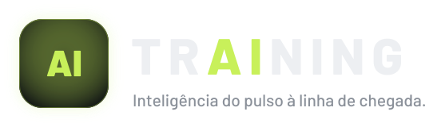
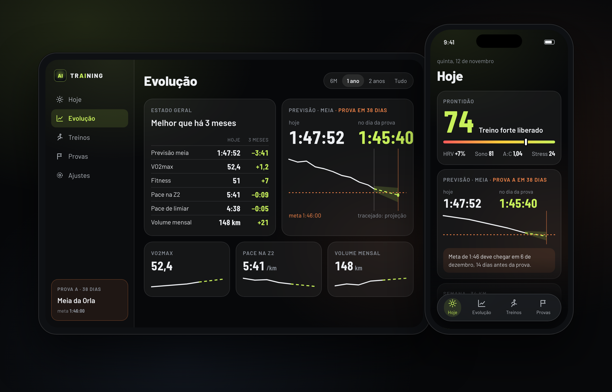

<p align="center">
  <picture>
    <source media="(prefers-color-scheme: dark)" srcset="docs/assets/logo-dark.svg">
    <source media="(prefers-color-scheme: light)" srcset="docs/assets/logo-light.svg">
    
  </picture>
</p>

<p align="center">
  
</p>

App nativo de iPhone e iPad que lê os dados do Garmin pela Personal API e responde três perguntas: dá pra treinar forte hoje, estou melhorando, e em quanto tempo eu faço a próxima prova. Os números da imagem acima são de exemplo.

## O que o app faz

- **Hoje**: prontidão de 0 a 100 com veredito (descanso, moderado ou treino forte), fitness até a prova, previsão da prova-alvo hoje e no dia da prova, semana corrente, previsões para 5, 10, 21,1 e 42,2 km e o último treino comparado com os parecidos. O detalhe da prontidão mostra o que puxou a nota para cima e para baixo em relação ao seu normal dos últimos 30 dias.
- **Evolução**: estado geral contra 3 meses atrás e um card por métrica (VO2max, pace na Z2, pace de limiar, fitness, volume, HRV, sono, FC de repouso, durabilidade, força em subida e outras). Toda métrica tem histórico e projeção tracejada com faixa de incerteza; se a meta cruza a projeção, o app mostra a data estimada.
- **Treinos**: nota de 0 a 100 por corrida, juntando execução e esforço adequado, com a decomposição dos pontos. Parciais, mapa, curva de FC e zonas calculadas pela FC de limiar, ao lado das zonas do relógio.
- **Provas**: cadastro com meta e GPX, previsão contra a meta (tranquila, desafiadora ou agressiva), estratégia de pace por km pela inclinação, bloco semana a semana e checklist. Corridas com cara de prova no histórico aparecem com a pergunta "foi prova?" e, confirmadas, entram na previsão.
- Aviso de manhã com a prontidão do dia, quando o sono e o HRV da noite chegam.

## Dados

Tudo vem da [Personal API do Garmin Connect](https://github.com/garmin/connect-personal-api-python), com uma chave pessoal e só leitura.

| Vem do Garmin, como está | Calculado pelo trAIning |
|---|---|
| HRV da noite e faixa base | Prontidão e o detalhe por fator |
| Sono: duração, fases e nota | Fitness, fadiga, forma e razão aguda:crônica |
| Body Battery, stress, FC de repouso, respiração, SpO2 | VO2max suavizado, lido do `.FIT` de cada corrida |
| Zonas de FC e FC de limiar | Zonas pelo limiar, pace na Z2, pace de limiar |
| Atividades: distância, tempo, FC, carga, efeito de treino, parciais, dinâmica de corrida | Previsão por distância, projeções e data estimada da meta |
| Arquivo `.FIT` de cada corrida (processado e descartado) | Nota do treino, durabilidade, força em subida, estratégia de pace |

Todo número calculado pelo app traz o rótulo trAIning. A previsão de prova é "previsão trAIning", não a do Garmin. As fórmulas estão em [`docs/superpowers/specs/2026-11-07-training-design.md`](docs/superpowers/specs/2026-11-07-training-design.md).

As leituras em texto são geradas no aparelho pelo Foundation Models da Apple, a partir de números já calculados. Sem o modelo disponível, o app usa templates com os mesmos números.

## Requisitos

- iPhone ou iPad com iOS/iPadOS 26 ou mais novo.
- Mac com Xcode e SDK do iOS 26 ou mais novo, e [XcodeGen](https://github.com/yonaskolb/XcodeGen) (`brew install xcodegen`).
- Uma chave da Personal API, criada no Garmin Connect. A chave vale de 30 dias a 1 ano, conforme o que você escolher na criação.
- Uma conta Apple. A conta gratuita (Personal Team) basta.

## Como rodar

```bash
git clone https://github.com/adrianogl/training.git
cd training
xcodegen generate
open trAIning.xcodeproj
```

No Xcode, em Signing & Capabilities do target `trAIning`, escolha o seu time (com a conta gratuita aparece como "Personal Team"). Se o bundle id `dev.aglv.training` já estiver em uso por outra conta, troque o prefixo em `project.yml` e gere o projeto de novo.

Conecte o iPhone ou o iPad por cabo (ou pela mesma rede Wi-Fi, depois do primeiro pareamento), escolha o aparelho como destino e rode. Na primeira vez, o iOS pede para confiar no desenvolvedor em Ajustes > Geral > VPN e Gerenciamento de Dispositivos, e para ligar o Modo de Desenvolvedor.

Com o app aberto, vá em Ajustes, cole a chave da Personal API e toque em testar a conexão. A primeira carga baixa todo o histórico disponível, uma requisição por vez, e pode levar alguns minutos; o app já fica usável com o que chegou.

### Simulador

`scripts/dev-run.sh` gera o projeto, cria um simulador, compila, instala e abre o app. O script copia um banco local de `garmin-data/snapshot/` (pasta fora do git) para o simulador; sem ele, use `--snapshot <pasta>` apontando para um `store.sqlite` seu, ou rode pelo Xcode. Se existir `~/.config/garmin/connect-personal-api-key`, a chave é passada ao app pela variável `TRAINING_API_KEY`.

```bash
scripts/dev-run.sh               # compila e abre no simulador
scripts/dev-run.sh --test        # roda os testes
scripts/dev-run.sh --reset-data  # recopia o snapshot
```

### Conta gratuita: reinstalar a cada 7 dias

Com a conta gratuita, o perfil de instalação vence 7 dias depois de cada instalação. Depois disso o app não abre. Para voltar a usar, conecte o aparelho e rode de novo pelo Xcode (Product > Run). Os dados ficam, porque o bundle id é o mesmo; a chave continua no Keychain.

Cada aparelho busca os próprios dados no Garmin e guarda os seus; não há sincronização entre iPhone e iPad. A chave precisa ser colada em cada um.

## Privacidade

- Sem servidor. O app fala direto com a API do Garmin e com mais nada.
- Os dados ficam no aparelho, em SwiftData. Sem telemetria, sem analytics, sem iCloud.
- A chave fica no Keychain local, sem sincronização.
- Os arquivos `.FIT` são baixados, processados e descartados; o app guarda só o que extraiu deles.
- Em Ajustes, "Apagar dados locais" apaga treinos, dados diários e provas do aparelho. A chave continua no Keychain até você trocá-la.

Nenhum dado pessoal, chave, `.FIT` ou resposta da API faz parte deste repositório.

## Landing page

A página do projeto fica em [`docs/site/`](docs/site/): HTML e CSS estáticos, sem build, prontos para o GitHub Pages.

## Aviso

Projeto pessoal, fora da App Store, sem vínculo com o Garmin. "Garmin" aparece aqui só como referência à origem dos dados.
